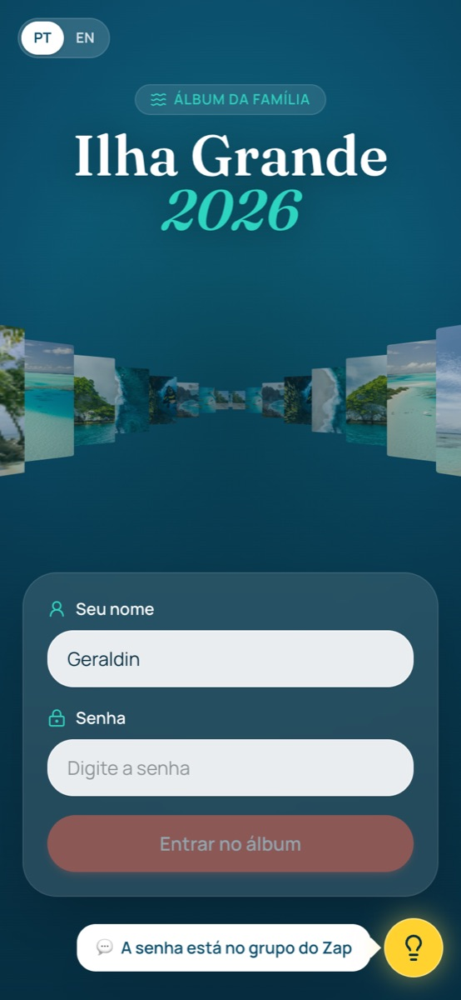
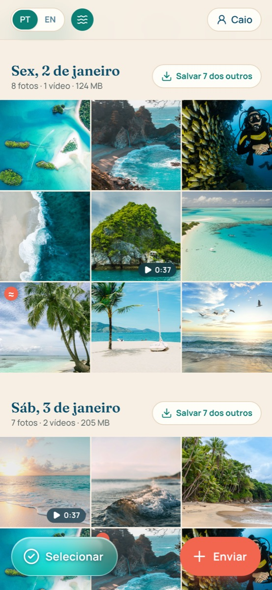
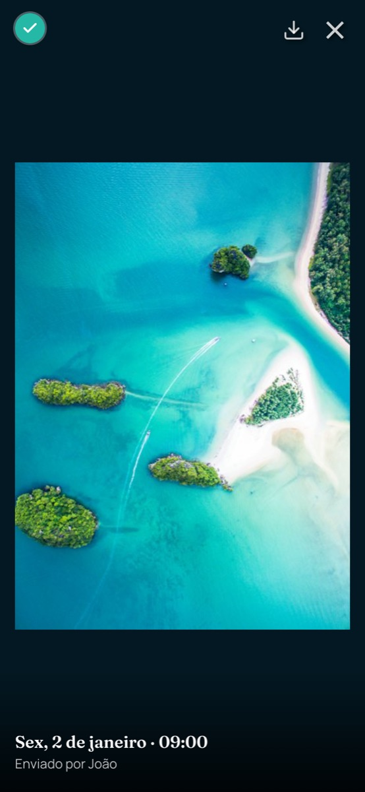
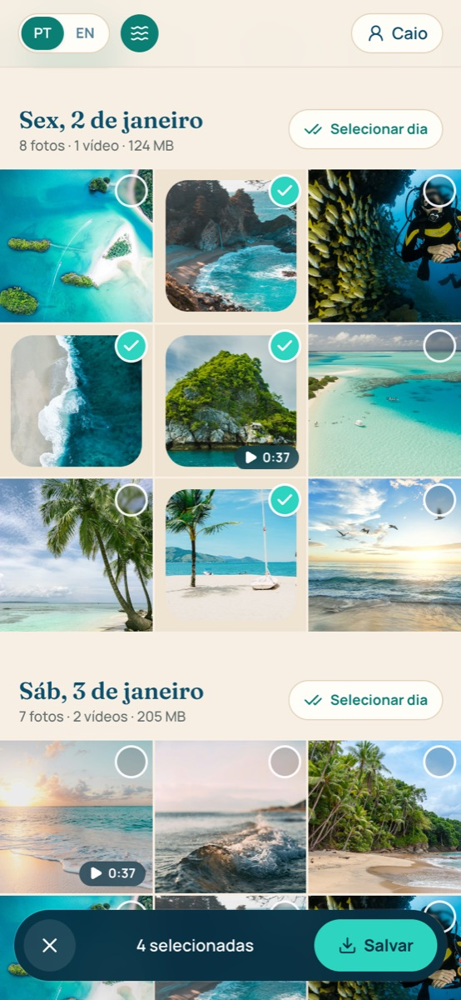
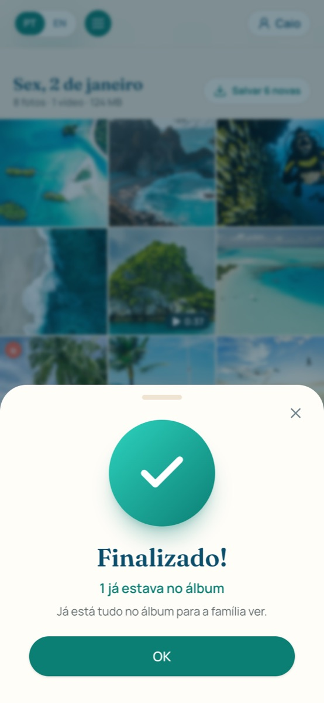
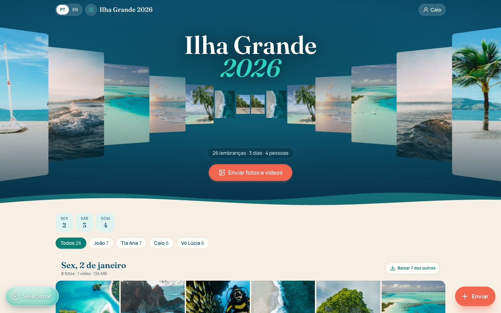
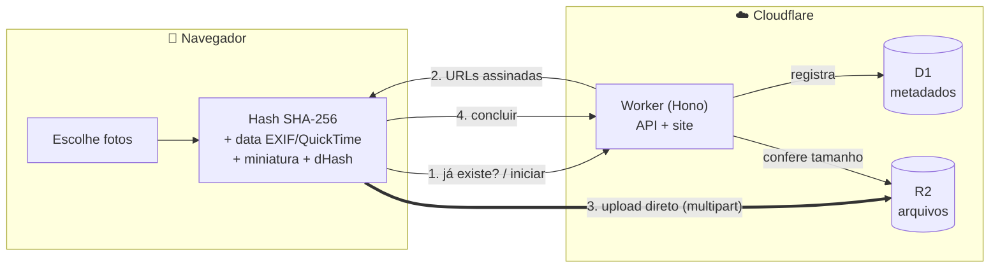

<div align="center">

# 🏝️ Angra Photos

**O álbum compartilhado da nossa viagem para Ilha Grande, em Angra dos Reis.**

Todo mundo manda as fotos e os vídeos direto da galeria do celular, em qualidade original,
e o site organiza tudo sozinho por dia e pela hora em que cada foto foi tirada.







</div>

---

## A história

Em outubro de 2026 fomos para Ilha Grande: hospedados na Pousada do Preto, no Bananal, com passeios
pelo Aventureiro, Ilha da Gipoia, Botinas e Lagoa Azul. Na volta, as fotos estavam espalhadas em
dezenas de celulares e num grupo de WhatsApp que **comprime tudo e apaga a data das fotos**.

Este projeto resolve isso com um site simples: um link, um nome, uma senha, e pronto. A maior parte
da turma tem mais de 60 anos, então cada tela foi pensada para quem não tem intimidade com tecnologia.
Funcionou: o pessoal aderiu e o álbum ficou completo.

---

## ✨ Por que ele é diferente

| | |
|---|---|
| 📅 **Ordem certa, sempre** | As fotos ficam na ordem em que foram **tiradas**, não na ordem de envio. A data é lida de dentro do arquivo: EXIF nas fotos, metadados QuickTime/MP4 nos vídeos, com fuso horário. |
| 🖼️ **Qualidade original** | Nada de compressão: o arquivo que chega é o mesmo que saiu do celular (HEIC, 4K, tudo). Diferente do WhatsApp. |
| 👵 **Feito para os avós** | Uma tela só com nome e senha, uma 💡 que lembra "a senha está no grupo do Zap", botões grandes, avisos claros e um círculo verde de **Finalizado!** quando termina. |
| 📲 **Salva direto na galeria** | No iPhone, a tela de compartilhar do iOS manda direto para o app Fotos. No Android, o original é baixado e aparece na Galeria. Um ✓ mostra o que você já salvou. |
| 🧠 **Detecta fotos repetidas** | Arquivos idênticos são ignorados (SHA-256). E a mesma foto recebida pelo WhatsApp, recomprimida, também é reconhecida por uma **impressão digital visual** (dHash), com aviso: *ignorar repetidas* ou *enviar mesmo assim*. |
| 💸 **Custa quase nada** | Roda no plano gratuito da Cloudflare. O R2 **não cobra download**, então assistir e baixar vídeos é grátis. Só se paga o armazenamento acima de 10 GB (cerca de US$ 0,015/GB/mês). |
| 🔒 **Privado de verdade** | Bucket fechado, arquivos servidos por URLs assinadas de curta duração, sessão por cookie HMAC e limite de tentativas na senha. |
| 🇧🇷🇺🇸 **Português e inglês** | Um toque em **PT \| EN** troca o site inteiro, com datas e números no formato de cada idioma. |

---

## 📸 Telas

<table>
  <tr>
    <td align="center"><br /><sub><b>Seleção</b>: toque ou segure o dedo, como na galeria do celular</sub></td>
    <td align="center"><br /><sub><b>Finalizado!</b>: o envio termina com uma confirmação clara</sub></td>
    <td align="center"><br /><sub><b>Tela cheia</b>: swipe, vídeo nativo e ✓ de já salvo</sub></td>
  </tr>
</table>



> As screenshots usam fotos de exemplo do Unsplash e nomes fictícios.

---

## 🧩 Funcionalidades

**Enviar**
- Seleção múltipla direto da galeria (fotos e vídeos), com progresso por arquivo.
- Upload **direto do navegador para o R2** por URLs pré-assinadas; os bytes não passam pelo servidor.
- Vídeos grandes (> 100 MB) vão em **multipart**: partes de 10 MB, 3 em paralelo, cada parte com retry. Se a internet cair, o envio continua **de onde parou**.
- 2 arquivos preparados e 4 enviados ao mesmo tempo; miniatura, preview e original sobem juntos.
- A tela fica acesa durante o envio (Wake Lock) e o site avisa antes de ser fechado no meio.
- Mídias sem data (prints, WhatsApp) ficam marcadas como **≈ data aproximada**, e quem enviou pode corrigir.

**Ver**
- Galeria agrupada por dia ("Sáb, 18 de outubro"), carregando cada dia só quando ele chega perto da tela.
- Atalhos para pular de dia, filtro por pessoa e um corredor animado de fotos no topo.
- Visualizador em tela cheia com swipe, zoom e player de vídeo nativo. O HEIC vira JPEG só para exibir: o download continua sendo o HEIC original.

**Salvar**
- **iPhone**: a tela de compartilhar do sistema abre com "Salvar Imagem / Salvar X itens", que vai para o Fotos.
- **Android**: download do original, que aparece na Galeria (álbum Download).
- **Computador**: download direto ou ZIP gerado em streaming por um service worker, sem estourar a memória.
- "Salvar o dia" pula o que você mesmo enviou e o que você já salvou antes.
- Modo **Selecionar** para escolher fotos soltas (inclusive segurando o dedo na foto).

**Gerenciar**
- Só quem enviou consegue apagar ou corrigir a data (proteção contra acidentes entre família).
- Limpeza automática diária de uploads abandonados no meio.

---

## 🏗️ Como funciona



| Etapa | Onde | Como |
|---|---|---|
| Sessão | Worker | Senha num secret do Worker. Ao acertar, cookie HMAC (HttpOnly, Secure, SameSite=Lax) por 30 dias. 5 tentativas a cada 15 min por IP. |
| Data de captura | Navegador | Fotos: `exifr` (DateTimeOriginal + OffsetTimeOriginal). Vídeos: leitor MP4/MOV próprio que lê `com.apple.quicktime.creationdate` (iPhone, com fuso) ou `mvhd.creation_time` (UTC). Tudo é guardado em UTC e exibido no horário de Brasília. |
| Miniaturas | Navegador | Canvas gera 480 px (grade) e 1600 px (tela cheia). HEIC no Android passa pelo `heic2any`, carregado só quando necessário. |
| Repetidas | Navegador + D1 | SHA-256 em streaming (`hash-wasm`) para arquivos idênticos. dHash de 64 bits para a mesma imagem recomprimida; duas fotos com data de câmera diferente nunca contam como repetidas (fotos em sequência). |
| Arquivos | R2 | Bucket privado. Miniaturas servidas pelo Worker com cache imutável; originais e vídeos por URL assinada de 10 min, com suporte a Range. |

### Decisões técnicas que valeram a pena

- **Leitor de MP4/MOV de ~200 linhas** em vez do `mp4box.js`: lê só os cabeçalhos e o bloco `moov`, ou seja, alguns KB mesmo num vídeo de 2 GB.
- **Hash em blocos de 4 MB**: o `crypto.subtle` exigiria carregar o vídeo inteiro na memória, o que derruba o Safari do iPhone.
- **ZIP montado pelo service worker**: o navegador grava direto no disco enquanto os arquivos chegam, em vez de juntar gigabytes na memória.
- **Tudo num Worker só**: API e site no mesmo domínio, o que simplifica o cookie de sessão e deixa o deploy em um comando.

---

## 🛠️ Stack

| Camada | Tecnologia |
|---|---|
| Front | Vite, React 19, TypeScript, Tailwind CSS v4, componentes no padrão shadcn/ui, lucide-react |
| Visualizador | yet-another-react-lightbox |
| Mídia no navegador | exifr, heic2any, hash-wasm, client-zip, leitor MP4 próprio, dHash próprio |
| Backend | Cloudflare Workers + Hono, aws4fetch (assinatura S3) |
| Dados | Cloudflare R2 (arquivos) e D1/SQLite (metadados) |

---

## 💰 Custos

| Serviço | Plano gratuito | Na prática |
|---|---|---|
| R2: armazenamento | 10 GB/mês | Acima disso, ~US$ 0,015/GB/mês. 50 GB ≈ US$ 0,60/mês |
| R2: download | **ilimitado** | Ver e baixar não custa nada |
| Workers | 100 mil requisições/dia | Arquivos estáticos não contam |
| D1 | 5 GB | Alguns MB |

Uma viagem de 8 pessoas e 5 dias, com fotos e vídeos 4K, ocupa por volta de 50 GB, ou seja, **menos de R$ 5 por mês** enquanto o álbum estiver no ar.

---

## 🚀 Rodando o seu

### Pré-requisitos
- Node.js 20+
- Conta gratuita na [Cloudflare](https://dash.cloudflare.com/sign-up), com o **R2 ativado** (a Cloudflare pede um cartão, mesmo no plano gratuito)

```bash
npm install
npx wrangler login
```

### 1. Bucket e banco
```bash
npx wrangler r2 bucket create album-ilha-grande
npx wrangler d1 create album-db
```
No [wrangler.toml](wrangler.toml), troque o `database_id` pelo que o comando mostrou e o `R2_ACCOUNT_ID` pelo da sua conta (painel → R2 → Account ID). Depois crie as tabelas:
```bash
npm run db:migrate
```

### 2. Token S3 do R2
Painel → **R2** → **Manage API tokens** → **Create API token**, com permissão **Object Read & Write** só para o bucket. Guarde o *Access Key ID* e o *Secret Access Key*.

### 3. Deploy e secrets
```bash
npm run deploy
npx wrangler secret put SHARED_PASSWORD        # a senha do grupo
npx wrangler secret put SESSION_SECRET         # openssl rand -base64 32
npx wrangler secret put R2_ACCESS_KEY_ID
npx wrangler secret put R2_SECRET_ACCESS_KEY
```

### 4. CORS do bucket
Coloque a URL do seu site em [r2-cors.json](r2-cors.json) e rode:
```bash
npx wrangler r2 bucket cors set album-ilha-grande --file r2-cors.json
```

Pronto. Para trocar a senha depois, é só rodar `secret put SHARED_PASSWORD` de novo.

### Desenvolvimento local
```bash
cp .dev.vars.example .dev.vars     # senha e chaves de teste
npm run db:migrate:local
npm run build && npm run dev:api   # http://localhost:8787
npm run dev                        # opcional: Vite com recarga em http://localhost:5173
```
O envio de arquivos usa o R2 de verdade; para testá-lo localmente, use `npm run dev:api:remote`.

### Personalizar
- **Textos e idiomas:** [src/lib/i18n.tsx](src/lib/i18n.tsx), incluindo a história do rodapé.
- **Cores:** variáveis no topo de [src/index.css](src/index.css) (`--aqua`, `--teal`, `--ocean`, `--sand`, `--coral`).
- **Fotos da tela de entrada:** `public/hero/01.jpg … 12.jpg`. Elas são públicas, porque aparecem antes do login.

---

## 📁 Estrutura

```
├─ worker/            API (Hono): sessão, upload, mídia, arquivos, assinatura S3
├─ migrations/        SQL do D1 (tabelas e impressão digital visual)
├─ shared/            tipos, datas e ZIP usados pelo front, pelo Worker e pelo service worker
├─ sw/                service worker do ZIP em streaming
├─ src/
│  ├─ components/ui/  shadcn (button, dialog, sheet, input) + image-stream-hero
│  ├─ components/     telas: entrada, álbum, galeria, visualizador, envio, rodapé…
│  ├─ hooks/          useAlbum (galeria por dia) e useFila (fila de envio)
│  └─ lib/            fila de upload, data de captura, leitor MP4, miniaturas, dHash, i18n
└─ docs/screenshots/  imagens deste README
```

---

## ⚠️ Limitações conhecidas

- **Nenhum site consegue gravar direto na galeria.** No iPhone falta um toque em "Salvar Imagem"; no Android o arquivo vai para Downloads, que a Galeria mostra. Só um app nativo eliminaria isso.
- **"Só quem enviou apaga"** compara o nome digitado, então é proteção contra acidente, não segurança. Com senha compartilhada, todos são "a mesma pessoa" para o servidor.
- **Fotos recebidas pelo WhatsApp perdem a data original** e ficam como aproximadas; o ideal é quem tirou a foto enviar o original.

---

## 🗺️ Próximos passos

A ideia é transformar o álbum de uma viagem num produto para qualquer grupo:

- [ ] **Contas de usuário** (login com e-mail ou Google) no lugar da senha compartilhada
- [ ] **Cada pessoa cria a sua viagem** e convida os amigos por link
- [ ] **Permissões reais**: dono, quem pode enviar, quem só vê
- [ ] **Assinatura** por espaço de armazenamento, com plano gratuito para viagens pequenas
- [ ] Exportar o álbum completo e arquivar a viagem no fim
- [ ] App nativo para salvar direto na galeria

---

<div align="center">

Fotos de exemplo: [Unsplash](https://unsplash.com) · Corredor de imagens baseado no componente *Image Stream Hero*

**criado por Caio** 🏴‍☠️⛵

</div>
